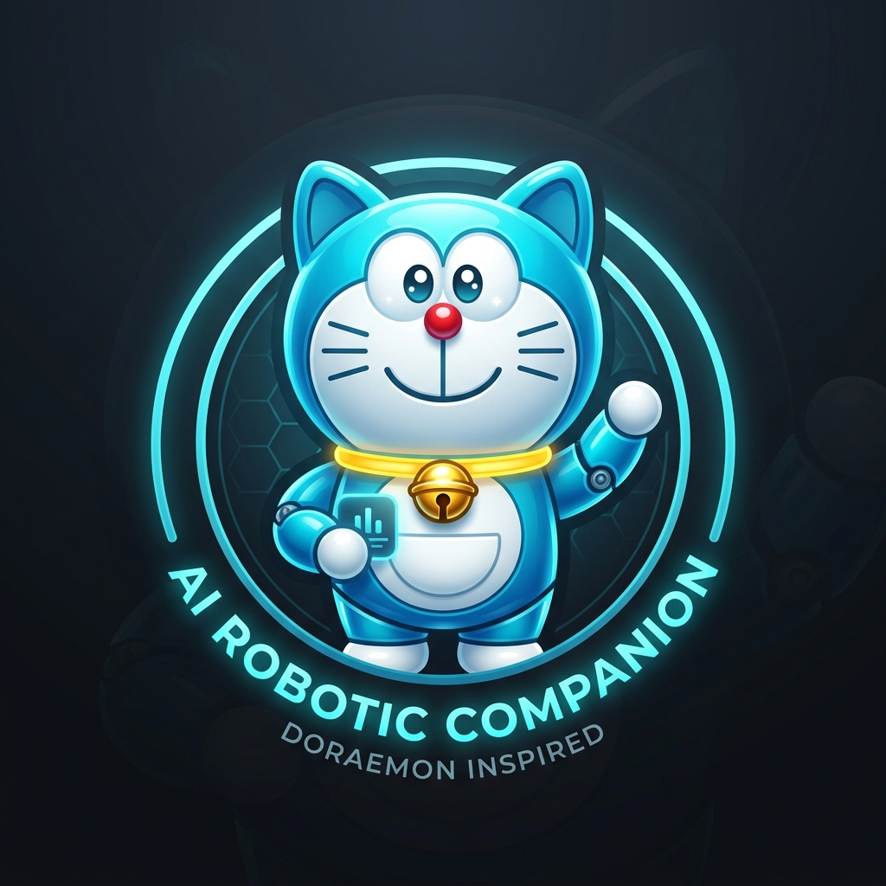

# DoraBot — 22nd Century Autonomous AI Companion 🛎️✨

DoraBot is an autonomous personal AI companion inspired by Doraemon, featuring 4D Pocket Gadgets, Mini-Dora specialist modes, and automated free smart model routing through OmniRoute and OpenRouter.



---

## 🌟 Key Features

1. **4D Pocket Gadget Engine (四次元ポケット)**
   - 🚪 **Anywhere Door (どこでもドア)**: Instant concept teleportation across web domains and technical knowledge bases.
   - 🚁 **Bamboo Copter (タケコプター)**: High-altitude 30,000-ft executive overview & strategic architectural perspectives.
   - 🍞 **Memory Bread (アンキパン)**: Toasts essential insights and notes into permanent digestible memory blocks.
   - 🍬 **Translation Gummy (ほんやくコンニャク)**: Universal multi-language translation and tech-to-plain-English simplification.
   - ⏳ **Time Machine (タイムマシン)**: Chronological evolution analysis, historical roots, and future technology projections.
   - 🔦 **Small Light (スモールライト)**: Distills verbose documents and dense code down by 80% to their pure essentials.

2. **Mini-Dora Specialist Squad**
   - 🔵 **DoraBot Prime**: 22nd Century general companion & witty conversation partner.
   - 🔴 **Mini-Dora Red (Turbo Code)**: High-speed reasoning, bug fixing, and clean architecture specialist.
   - 🟡 **Mini-Dora Yellow (Creative Ideation)**: Boundless brainstorming, novel thinking, and imaginative UX design.
   - 🟢 **Mini-Dora Green (Deep Knowledge)**: Fact synthesis, documentation analysis, and structured reporting.

3. **Free & Smart Model Routing via OmniRoute**
   - Automatically connects to the local **OmniRoute Bridge** (`http://127.0.0.1:20129`) with direct OpenRouter fallback.
   - Built-in multi-model pool featuring free high-capacity smart models:
     - `openrouter/free` (Auto-routing smart pool)
     - `nvidia/nemotron-3-nano-omni-30b-a3b-reasoning:free`
     - `google/gemma-4-31b-it:free`
     - `nvidia/nemotron-3.5-lightning:free`
     - `liquid/lfm-2.5-2.6b:free`
   - Resilient upstream error and rate-limit handling with automatic model failover.

4. **Firebase Authentication (Google Sign-In)**
   - Integrated with Firebase Auth (`signInWithPopup`, `signInWithRedirect`).
   - Project: `DoraBot`.
   - In-app Firebase credentials settings manager + offline Sandbox Google Sign-In demo mode.

5. **Autonomous Watchdog & Disk Safety**
   - Automatically keeps VM `/home` usage safely below 4.0GB.
   - Offloads build caches and node dependencies to root overlay (`/tmp` with 31GB free).
   - Live health monitoring API at `/api/system/health`.

---

## 🚀 Running DoraBot

```bash
# 1. Install dependencies (symlinked to /tmp for disk safety)
npm install

# 2. Start both Express Backend and Vite Frontend
npm run dev:all

# 3. Run the automated test suite
npm test
```
